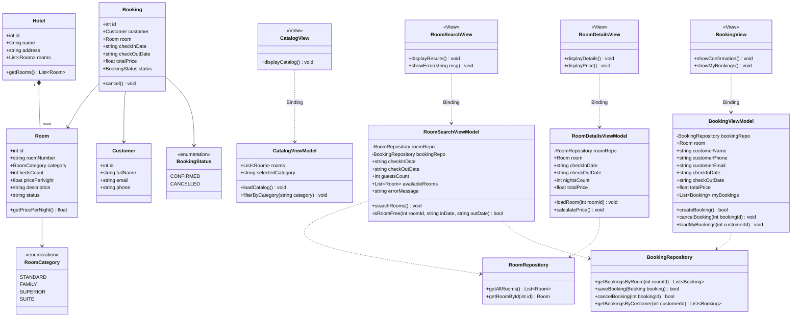
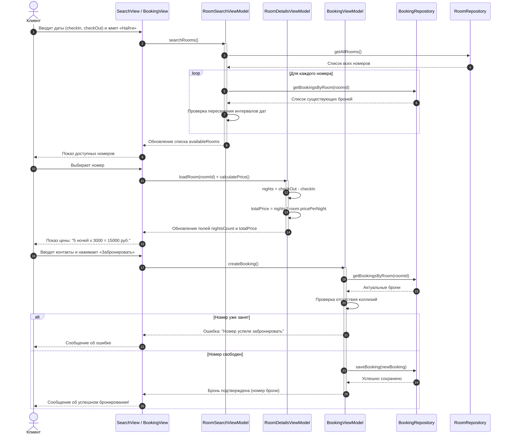

# Лабораторная работа №5
## Тема: Проектирование системы бронирования гостиницы (MVVM)
**Вариант 2**

* **Дисциплина:** Проектирование программных систем / Разработка приложений на PHP
* **Архитектурный паттерн:** MVVM (Model-View-ViewModel)
* **Формат сдачи:** Архитектурная документация и UML-модели (без написания кода реализации)

---

## 📌 Содержание
1. [Описание предметной области и задачи](#1-описание-предметной-области-и-задачи)
2. [Архитектура приложения (MVVM)](#2-архитектура-приложения-mvvm)
   - [Модель (Model)](#слой-model-модель)
   - [Модель представления (ViewModel)](#слой-viewmodel-модель-представления)
   - [Представление (View)](#слой-view-представление)
3. [UML-диаграммы](#3-uml-диаграммы)
   - [Диаграмма классов (Class Diagram)](#диаграмма-классов-class-diagram)
   - [Диаграмма последовательности (Sequence Diagram)](#диаграмма-последовательности-sequence-diagram)
4. [Описание алгоритмов](#4-описание-алгоритмов)
   - [Алгоритм проверки пересечения дат (коллизий)](#алгоритм-проверки-пересечения-дат)
   - [Алгоритм расчета стоимости проживания](#алгоритм-расчета-стоимости)
5. [Спецификация интерфейсов и связывание (Data Binding)](#5-спецификация-интерфейсов-и-связывание-data-binding)
   - [Формат передачи данных (DTO)](#структуры-данных-dto)
   - [Таблица привязки View к ViewModel](#таблица-связывания-view-и-viewmodel)
6. [Бизнес-правила системы](#6-бизнес-правила-системы)

---

## 1. Описание предметной области и задачи

Цель работы — спроектировать систему для автоматизации бронирования номеров в гостинице с использованием паттерна MVVM.

### Основные возможности системы:
* **Каталог номеров:** просмотр всех номеров гостиницы, разбитых по категориям (стандарт, семейный, люкс и др.), с указанием цены, описания и количества спальных мест.
* **Поиск по датам:** выбор дат заезда и выезда, количества гостей и вывод только тех номеров, которые свободны на этот интервал.
* **Карточка номера:** просмотр подробного описания выбранного номера и автоматический расчет стоимости проживания по формуле ($сутки \times цена$).
* **Оформление брони:** ввод данных клиента (ФИО, телефон, email), повторная проверка на занятость и сохранение бронирования.
* **Личный кабинет / Управление:** просмотр списка своих бронирований и возможность отменить бронь.

---

## 2. Архитектура приложения (MVVM)

В соответствии с заданием архитектура разделена на три основных слоя:

```
┌────────────────────────────────────────────────────────┐
│                      VIEW (Экран)                      │
│   Пассивные страницы и формы (HTML / шаблоны UI).      │
│   Никаких вычислений и запросов к БД. Только показ     │
│   данных и передача кликов/ввода во ViewModel.         │
└───────────────────────────▲────────────────────────────┘
                            │ Data Binding (Привязка данных)
┌───────────────────────────▼────────────────────────────┐
│                  VIEWMODEL (Логика UI)                 │
│   Хранит состояние экрана (поля ввода, списки, ошибки). │
│   Содержит команды (поиск, расчет, бронирование).      │
│   Обращается к Модели и готовит данные для View.       │
└───────────────────────────▲────────────────────────────┘
                            │ Вызовы методов / DTO
┌───────────────────────────▼────────────────────────────┐
│                     MODEL (Данные)                     │
│   Сущности (Hotel, Room, Customer, Booking).           │
│   Классы для работы с базой данных (Репозитории).      │
│   Хранят правила данных и свойства объектов.           │
└────────────────────────────────────────────────────────┘
```

### Слой Model (Модель)
Отвечает за сами данные и логику их хранения:
* **`Hotel`** — содержит общую информацию о гостинице (название, адрес) и список всех номеров.
* **`Room`** — сущность номера гостиницы: уникальный номер (комната), категория (стандарт, семейный и т.д.), спальные места, цена за сутки, описание и статус (доступен, на ремонте).
* **`Customer`** — данные клиента: идентификатор, ФИО, телефон, email.
* **`Booking`** — запись о бронировании: связывает клиента и номер, хранит дату заезда, дату выезда, итоговую стоимость и статус (подтверждено, отменено).
* **Репозитории (`RoomRepository`, `BookingRepository`, `CustomerRepository`)** — классы для получения и сохранения данных в БД.

### Слой ViewModel (Модель представления)
Связующее звено между экраном и данными. Вся логика экранов находится здесь:
* **`CatalogViewModel`** — загружает каталог номеров, хранит выбранную категорию и фильтрует список.
* **`RoomSearchViewModel`** — хранит введенные пользователем даты заезда/выезда, проверяет их корректность и ищет свободные номера (отсекая те, на которые уже есть бронь).
* **`RoomDetailsViewModel`** — загружает данные конкретного номера, считает количество суток и умножает на цену за ночь.
* **`BookingViewModel`** — проверяет, не заняли ли номер перед самым подтверждением, сохраняет клиента и создает бронь, а также загружает историю бронирований и отменяет их.

### Слой View (Представление)
Пользовательский интерфейс (формы, списки, карточки). По требованию задания **View полностью пассивна**:
* Не считает стоимость;
* Не выполняет циклы поиска и фильтрации;
* Только отображает поля из ViewModel и при нажатии на кнопки вызывает команды ViewModel.

---

## 3. UML-диаграммы

### Диаграмма классов (Class Diagram)



---

### Диаграмма последовательности (Sequence Diagram)

Сценарий: **Поиск номера ➔ Проверка на занятость ➔ Расчет стоимости ➔ Оформление брони**.



---

## 4. Описание алгоритмов

### Алгоритм проверки пересечения дат

#### Логика работы
Гостиничные сутки считаются с даты заезда (обычно 14:00) до даты выезда (12:00).  
Это означает, что один клиент может **выехать** 10-го числа, а другой клиент в этот же день 10-го числа может **заехать**. То есть границы дат в один день не считаются пересечением.

Интервал бронирования является полуоткрытым: `[ДатаЗаезда, ДатаВыезда)`.

Два периода бронирования:
1. Запрашиваемый клиентом: `(checkIn, checkOut)`
2. Уже существующая бронь: `(existIn, existOut)`

Они **пересекаются** (номер занят), если выполняется условие:
```text
(checkIn < existOut) И (checkOut > existIn)
```

Если существующая бронь отменена (`status == CANCELLED`), она не учитывается.

#### Псевдокод функции проверки:

```text
функция isRoomFree(roomId, newIn, newOut):
    если newIn >= newOut то:
        вернуть Ошибка("Дата выезда должна быть позже даты заезда")

    брони = BookingRepository.getBookingsByRoom(roomId)

    для каждой брони из брони:
        если бронь.статус == "CANCELLED" то:
            пропустить

        // Проверяем наложение дат
        если (newIn < бронь.checkOutDate) И (newOut > бронь.checkInDate) то:
            вернуть ЛОЖЬ // Номер занят на эти дни!

    вернуть ИСТИНА // Пересечений нет, номер свободен
```

---

### Алгоритм расчета стоимости

#### Логика работы
1. Вычисляется разница между датой выезда и датой заезда в сутках.
2. Количество суток умножается на базовую цену номера за одну ночь.

#### Формула:
$$\text{Количество суток} = \text{ДатаВыезда} - \text{ДатаЗаезда}$$
$$\text{Итоговая стоимость} = \text{Количество суток} \times \text{Цена за сутки}$$

#### Псевдокод расчета:

```text
функция calculatePrice(room, checkIn, checkOut):
    если checkOut <= checkIn то:
        вернуть 0

    суток = дниМежду(checkIn, checkOut)
    итого = суток * room.pricePerNight

    вернуть итого
```

---

## 5. Спецификация интерфейсов и связывание (Data Binding)

В паттерне MVVM экран (View) связывается с моделью представления (ViewModel) через привязку свойств и вызов методов.

### Структуры данных (DTO)

Для передачи данных на экран используются простые структуры:

```json
// Карточка номера в списке
{
  "roomId": 12,
  "roomNumber": "204",
  "category": "Люкс",
  "beds": 2,
  "pricePerNight": 4500,
  "status": "Доступен"
}

// Данные оформленной брони
{
  "bookingId": 105,
  "roomNumber": "204",
  "clientName": "Иванов Иван",
  "checkIn": "2026-12-10",
  "checkOut": "2026-12-15",
  "totalPrice": 22500,
  "status": "Подтверждено"
}
```

### Таблица связывания View и ViewModel

| Экран (View) | Элемент интерфейса | Поле / Метод во ViewModel | Что происходит |
|---|---|---|---|
| **Поиск номеров** | Поле ввода «Дата заезда» | `checkInDate` | Пользователь выбирает дату заезда |
| **Поиск номеров** | Поле ввода «Дата выезда» | `checkOutDate` | Пользователь выбирает дату выезда |
| **Поиск номеров** | Кнопка «Найти» | метод `searchRooms()` | Запускается фильтрация свободных номеров |
| **Поиск номеров** | Список номеров на экране | `availableRooms` | View просто выводит список полученных карточек |
| **Карточка номера** | Текст «Итоговая цена» | `totalPrice` | Автоматически показывает расчет при смене дат |
| **Карточка номера** | Кнопка «Забронировать» | переход на оформление | Открывает экран бронирования |
| **Оформление брони**| Поля ввода ФИО, телефон | `customerName`, `customerPhone` | Заполнение данных клиента |
| **Оформление брони**| Кнопка «Подтвердить» | метод `createBooking()` | Сохранение брони с проверкой коллизий |
| **Мои бронирования**| Список броней | `myBookings` | Отображение истории заказов |
| **Мои бронирования**| Кнопка «Отменить» | метод `cancelBooking(id)` | Смена статуса брони на отмененный |

---

## 6. Бизнес-правила системы

1. **Запрет двойного бронирования:** Один и тот же номер не может быть одновременно забронирован двумя разными клиентами на пересекающиеся даты.
2. **Пассивность View:** Представление не выполняет поиск и не считает деньги в шаблонах. Все расчеты делает ViewModel.
3. **Фиксация стоимости:** При создании брони итоговая стоимость записывается в заказ и больше не меняется (даже если в будущем отель изменит цену за сутки этого номера).
4. **Освобождение при отмене:** Если клиент отменяет бронь, статус меняется на `CANCELLED`, и номер снова начинает появляться в поиске на эти даты.
